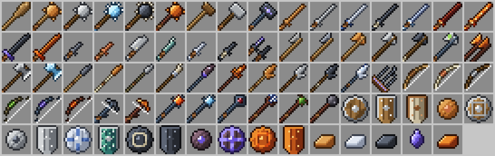

# Valheim Arsenal

A Fabric mod that brings Valheim's weapons to **Minecraft Java Edition 26.3** — 59 weapons, 15 shields and 5 crafting materials, each with its own 16×16 sprite drawn in the vanilla style, and Valheim's combat mechanics: secondary attacks, backstabs, 3-hit combos, parries, staggers, damage types and elemental damage. It also adds the **Mistlands** biome to the overworld.



| | |
|---|---|
| Minecraft | Java Edition 26.3 |
| Loader | Fabric Loader 0.19.5 or newer |
| Requires | Fabric API 0.161.0+26.3 or newer |
| Java | 25 |

## Getting the .jar

The source here has to be built once into a `.jar`.

**Easiest — let GitHub build it.** Create a new GitHub repository, upload this folder, and open the **Actions** tab. The included workflow builds the mod on every push; the finished jar is under the run's **Artifacts**.

**On your own computer.** Install a Java 25 JDK, then in this folder run:

```
./gradlew build          (Windows: gradlew.bat build)
```

The mod is written to `build/libs/valheim-arsenal-1.1.0.jar`.

**Installing.** Put that jar and [Fabric API](https://modrinth.com/mod/fabric-api) for 26.3 into your `.minecraft/mods` folder and launch the Fabric 26.3 profile. Everything is in the **Valheim Arsenal** creative tab, and all recipes appear in the recipe book as soon as you join a world.

> Note: this was written against Fabric's and Mojang's published 26.3 changes, but the machine it was made on couldn't download Minecraft to compile it. If the first build reports an error, the message names the exact file and line — it should be a one-line fix.

## Controls

| Action | How |
|---|---|
| Normal attack (with Valheim's extras) | Left click |
| **Secondary attack** (Valheim's middle mouse) | Right click — or **sneak + right click** if you hold a shield in your off hand |
| Block | Right click with a shield in your off hand |
| **Parry** | Raise the shield just as a hit lands |
| Cast a staff | Right click |

## Combat mechanics

- **Secondary attacks.** Every melee family has Valheim's right-click move, with a cooldown and a stamina cost:
  - Clubs & maces — *Uppercut*: 2× damage, heavy knockback, staggers.
  - Sledges — *Ground Slam*: hits and staggers everything in front of you.
  - Swords — *Lunge*: dash forward and stab for 3×.
  - Greatswords (Krom, Slayer) — *Whirlwind*: 1.5× to everything around you.
  - Knives — *Leap*: jump forward and stab for 2×.
  - Axes — *Heavy Chop*: 2× and a short stagger.
  - Battleaxes — *Haft Bash*: shoves up to 3 enemies back and staggers them.
  - Spears — *Throw*: hurl the spear; it lands where it hits and you go and pick it up.
  - Atgeirs — *Spin*: sweep everything around you.
  - Claws — *Heavy Blow*: 2×, knockback, staggers.
- **Primary attack extras.** Sledges send out an impact shockwave; battleaxes cleave into enemies beside the target; swords and greatswords sweep.
- **3-hit combo.** The third hit of a quick chain deals 1.5×.
- **Backstab.** Enemies that haven't noticed you take 3× (knives 6×), with bows too. Each enemy can only be backstabbed once every 5 minutes, as in Valheim.
- **Parry & riposte.** Block right as a hit lands: you take nothing, the attacker staggers, projectiles shatter, and your next hit within 2 seconds deals 2×. Bucklers have the widest window; tower shields can't parry but block almost everything.
- **Stagger.** A staggered enemy can barely move and hits weakly for a moment.
- **Damage types.** Blunt weapons deal +50% to skeletons; piercing weapons −25%. **Spirit** damage adds bonus damage to the undead. **Fire** burns, **Frost** slows and chills (powder-snow freeze), **Poison** poisons, **Lightning** arcs to up to three nearby enemies.
- **Stamina & eitr.** Special attacks and spells cost hunger (Minecraft's closest equivalent). At 3 drumsticks or less you're out of stamina. **Blood magic** (Staff of Protection) costs 40% of your current health instead.
- **Reach & weight.** Atgeirs reach further, knives less. Two-handed weapons and tower shields slow you slightly.
- **Bows & crossbows.** Arrow damage scales with the bow (Crude ×0.83 up to Ash Fang ×1.6); Draugr Fang poisons, Spinesnap and Ash Fang deal spirit damage. Crossbow bolts hit for ×1.8–1.9 and fly flatter.
- **Staves.** Embers (exploding fireball), Frost (spray of ice shards), Protection (absorption shield for you and nearby allies), Dundr (lightning where you aim), Staff of the Wild (roots that hold enemies), Staff of Fracturing (a line of erupting stone).
- **Butcher knife.** Kills animals in one blow and does nothing to anything else.
- Axes and battleaxes chop wood and strip logs. All items take vanilla enchantments for their type, and Ashlands gear doesn't burn in lava.

## The Mistlands

A misty, purple-grey biome that takes the place of some dark forests, old-growth taigas and windswept forests in new chunks.

- Thick mist: you can only see about 48 blocks, and ash-like motes drift through the air.
- Dark, rocky ground: patches of tuff and moss among dusky grass, with mossy boulders.
- Dark oaks and giant mushrooms, pale moss, and the deep dark music.
- Dangerous: many more spiders and cave spiders (Valheim's Seekers and ticks), plus endermen.
- Woodland mansions, mineshafts, trail ruins, trial chambers and ruined portals still generate there.

Use a **new world** (or explore far away from where you've been) to find it; `/locate biome valheim_arsenal:mistlands` points you to the nearest one. The biome is added with [TerraBlender](https://github.com/Glitchfiend/TerraBlender), which is bundled inside the Valheim Arsenal jar, so there's nothing extra to install. How often it appears is `MISTLANDS_WEIGHT` in `ValheimTerraBlender.java`; its look, spawns and features are in `data/valheim_arsenal/worldgen/biome/mistlands.json`.

## Crafting

Valheim recipes are material lists, so every recipe here is **shapeless** at a crafting table. Valheim's metals are alloyed from vanilla materials:

| Material | Recipe |
|---|---|
| Bronze Ingot | 2 copper ingots + 1 iron nugget |
| Silver Ingot | 1 iron ingot + 2 nether quartz |
| Black Metal Ingot (×2) | 2 iron ingots + 1 diamond + 1 coal |
| Refined Eitr | 2 sculk + 1 lapis lazuli + 1 glowstone dust |
| Flametal Ingot | 1 netherite scrap + 1 gold ingot + 1 blaze powder + 1 magma cream |

Other Valheim materials map to vanilla look-alikes: leather scraps → leather, carapace → armadillo scute, serpent scale → turtle scute, chitin → nautilus shell, crystal → amethyst, Yggdrasil wood → cherry log, Ashlands wood → crimson stem, ancient bark → dark oak log. The recipe book shows every recipe's ingredients.

## Weapons

Valheim's base stats are shown in each tooltip; Minecraft damage is scaled so an Iron Sword (Valheim 55) hits for 6.5, a little above vanilla's iron sword, and endgame weapons sit just above netherite.

| Weapon | Type | Tier | Valheim stats | In Minecraft |
|---|---|---|---|---|
| Club | Club/mace | Meadows | Blunt 12 | 3.5 dmg, 1.2/s |
| Bronze Mace | Club/mace | Black Forest | Blunt 35 | 5 dmg, 1.2/s |
| Iron Mace | Club/mace | Swamp | Blunt 55 | 6.5 dmg, 1.2/s |
| Frostner | Club/mace | Mountains | Blunt 35 · Frost 40 · Spirit 20 | 5 dmg, 1.2/s |
| Porcupine | Club/mace | Plains | Blunt 50 · Pierce 45 | 8.5 dmg, 1.2/s |
| Flametal Mace | Club/mace | Ashlands | Blunt 135 | 10 dmg, 1.2/s |
| Stagbreaker | Sledge | Meadows | Blunt 20 · Pierce 5 | 5.5 dmg, 0.85/s |
| Iron Sledge | Sledge | Swamp | Blunt 55 | 8 dmg, 0.7/s |
| Demolisher | Sledge | Mistlands | Blunt 145 | 12 dmg, 0.7/s |
| Bronze Sword | Sword | Black Forest | Slash 35 | 5 dmg, 1.6/s |
| Iron Sword | Sword | Swamp | Slash 55 | 6.5 dmg, 1.6/s |
| Silver Sword | Sword | Mountains | Slash 75 · Spirit 30 | 7.5 dmg, 1.6/s |
| Blackmetal Sword | Sword | Plains | Slash 95 | 8.5 dmg, 1.6/s |
| Mistwalker | Sword | Mountains | Slash 75 · Frost 40 · Spirit 15 | 7.5 dmg, 1.6/s |
| Nidhögg | Sword | Ashlands | Slash 135 | 10 dmg, 1.6/s |
| Dyrnwyn | Sword | Ashlands | Slash 145 · Fire 10 | 10 dmg, 1.6/s |
| Krom | Greatsword | Mistlands | Slash 150 | 12.5 dmg, 1/s |
| Slayer | Greatsword | Ashlands | Slash 170 | 13 dmg, 1/s |
| Flint Knife | Knife | Meadows | Slash 5 · Pierce 5 | 3 dmg, 2.2/s |
| Copper Knife | Knife | Black Forest | Slash 12 · Pierce 12 | 4.5 dmg, 2.2/s |
| Butcher Knife | Knife (butcher) | Swamp | Pure 1000 (animals only) | kills animals |
| Abyssal Razor | Knife | Swamp | Slash 20 · Pierce 20 | 5.5 dmg, 2.2/s |
| Silver Knife | Knife | Mountains | Slash 25 · Pierce 25 · Spirit 12 | 6 dmg, 2.2/s |
| Blackmetal Knife | Knife | Plains | Slash 34 · Pierce 34 | 7 dmg, 2.2/s |
| Skoll and Hati | Knife | Mistlands | Slash 45 · Pierce 45 | 8 dmg, 2.6/s |
| Stone Axe | Axe | Meadows | Slash 15 | 3.5 dmg, 1/s |
| Flint Axe | Axe | Meadows | Slash 20 | 4 dmg, 1/s |
| Bronze Axe | Axe | Black Forest | Slash 40 | 5.5 dmg, 1/s |
| Iron Axe | Axe | Swamp | Slash 60 | 6.5 dmg, 1/s |
| Blackmetal Axe | Axe | Plains | Slash 100 | 8.5 dmg, 1/s |
| Jotun Bane | Axe | Mistlands | Slash 80 · Poison 40 | 7.5 dmg, 1/s |
| Berserkir Axes | Axe | Ashlands | Slash 140 | 10 dmg, 1.4/s |
| Battleaxe | Battleaxe | Mountains | Slash 70 | 8.5 dmg, 0.8/s |
| Crystal Battleaxe | Battleaxe | Mountains | Slash 90 · Spirit 30 | 9.5 dmg, 0.8/s |
| Flint Spear | Spear | Meadows | Pierce 20 | 4 dmg, 1.3/s |
| Bronze Spear | Spear | Black Forest | Pierce 35 | 5 dmg, 1.3/s |
| Ancient Bark Spear | Spear | Swamp | Pierce 55 | 6.5 dmg, 1.3/s |
| Fang Spear | Spear | Mountains | Pierce 75 | 7.5 dmg, 1.3/s |
| Carapace Spear | Spear | Mistlands | Pierce 115 | 9 dmg, 1.3/s |
| Splitnir | Spear | Ashlands | Pierce 135 | 10 dmg, 1.3/s |
| Bronze Atgeir | Atgeir | Black Forest | Pierce 45 | 7 dmg, 1.1/s |
| Iron Atgeir | Atgeir | Swamp | Pierce 65 | 8.5 dmg, 1.1/s |
| Blackmetal Atgeir | Atgeir | Plains | Pierce 105 | 10 dmg, 1.1/s |
| Himminafl | Atgeir | Mistlands | Pierce 85 · Lightning 40 | 9.5 dmg, 1.1/s |
| Flesh Rippers | Claws | Mistlands | Slash 60 | 6.5 dmg, 2/s |
| Crude Bow | Bow | Meadows | Pierce 22 | arrows ×0.83 |
| Finewood Bow | Bow | Black Forest | Pierce 32 | arrows ×1.0 |
| Huntsman Bow | Bow | Swamp | Pierce 42 | arrows ×1.15 |
| Draugr Fang | Bow | Mountains | Pierce 47 · Poison 20 | arrows ×1.21 |
| Spinesnap | Bow | Mistlands | Pierce 72 · Spirit 20 | arrows ×1.5 |
| Ash Fang | Bow | Ashlands | Pierce 82 · Spirit 15 | arrows ×1.6 |
| Arbalest | Crossbow | Mistlands | Pierce 200 | arrows ×1.8 |
| Ripper | Crossbow | Ashlands | Pierce 220 | arrows ×1.9 |
| Staff of Embers | Staff | Mistlands | Blunt 120 · Fire 120 | spell 10 |
| Staff of Frost | Staff | Mistlands | Frost 30 | spell 3.5 |
| Staff of Protection | Staff | Mistlands |  | spell 0 |
| Dundr | Staff | Ashlands | Lightning 25 | spell 10 |
| Staff of the Wild | Staff | Ashlands | Blunt 55 | spell 7 |
| Staff of Fracturing | Staff | Ashlands | Blunt 30 | spell 8 |

### Shields

| Shield | Type | Tier | Valheim block armor | Blocks |
|---|---|---|---|---|
| Wood Shield | Round | Meadows | 6 | 70% |
| Wood Tower Shield | Tower | Meadows | 10 | 80% |
| Bone Tower Shield | Tower | Black Forest | 32 | 85% |
| Bronze Buckler | Buckler | Black Forest | 16 | 60% |
| Banded Shield | Round | Swamp | 42 | 85% |
| Iron Buckler | Buckler | Swamp | 28 | 70% |
| Iron Tower Shield | Tower | Swamp | 52 | 95% |
| Silver Shield | Round | Mountains | 60 | 90% |
| Serpent Scale Shield | Tower | Mountains | 60 | 95% |
| Blackmetal Shield | Round | Plains | 78 | 92% |
| Blackmetal Tower Shield | Tower | Plains | 104 | 100% |
| Carapace Buckler | Buckler | Mistlands | 78 | 85% |
| Carapace Shield | Round | Mistlands | 96 | 95% |
| Flametal Shield | Round | Ashlands | 114 | 97% |
| Flametal Tower Shield | Tower | Ashlands | 140 | 100% |

### Not included

The two summoning staves (Dead Raiser, Trollstav), the Ashlands elemental variants of each weapon, bombs, the torch, the Abyssal Harpoon, special arrow and bolt types, and the weapons added in Valheim 1.0 / Deep North (their stats weren't published where I could verify them).

## Changing things

Every number, recipe and sprite comes from `tools/catalog.py`. Edit it, then regenerate the Java catalog, JSON files and textures with:

```
pip install pillow
python3 tools/generate.py
```

Sprite drawing lives in `tools/sprites.py`; combat code is in `src/main/java/com/valheimarsenal/combat`.

## Credits

A fan project. Valheim and its weapon names belong to Iron Gate AB; Minecraft belongs to Mojang. All textures in this mod are original pixel art. Not affiliated with or endorsed by either studio. TerraBlender by Glitchfiend is bundled under the LGPL-3.0.
